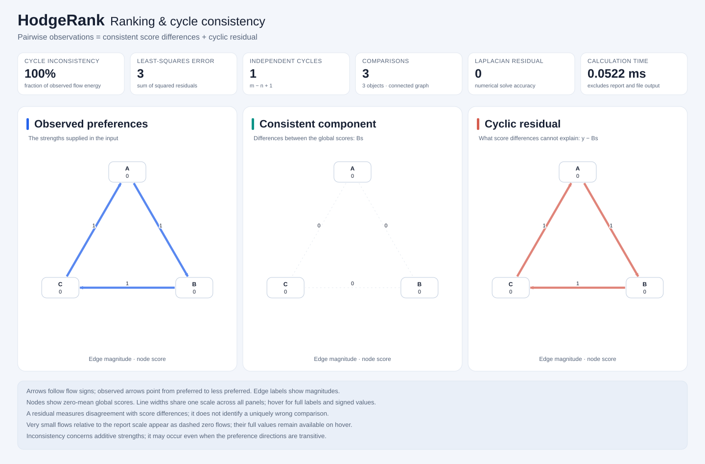

# HodgeRank: cycle consistency

Convert signed pairwise preferences into zero-mean global scores and measure the
part that cannot be explained by score differences. Supports connected graphs
with 3–20 objects and one observation per unordered pair.

## Build and test

Requires the .NET 11 SDK. Math.NET Numerics supplies the Cholesky factorization;
the implementation uses its managed provider and needs no native numerical library.

```sh
dotnet restore HodgeRank.slnx --locked-mode
dotnet test HodgeRank.slnx -c Release --no-restore
```

## Run

```sh
dotnet run --project src/HodgeRank.Cli -c Release -- demo
dotnet run --project src/HodgeRank.Cli -c Release -- analyze examples/rock-paper-scissors.json --json artifacts/result.json --svg artifacts/report.svg
```

The demo writes both input JSON files, result JSON files, and SVG reports to
`artifacts/demo`. Open the SVG files in a browser to compare observed, consistent,
and residual flows using identical node positions. Arrow direction follows the
sign of the flow; observed arrows point from preferred to less preferred objects.
Dense graphs hide edge labels; hover for exact values. Reports contain no scripts
or external assets. A large residual does not identify a uniquely wrong edge.

Use `--output <directory>` with `demo` to change its destination. Existing output
files require `--force`; input and output paths must remain distinct. Analysis
without output options prints scores and metrics without creating files. Run
`--help` for usage. Exit codes: 0 success/help, 2 invalid arguments or input data,
1 file/access error. Output files are replaced individually, not as a transaction;
an I/O failure can leave a partially written collection of reports.

JSON property names are case-sensitive camelCase. Unknown, missing, and duplicate
properties are rejected. Input files are limited to 1 MiB. Object names are
case-sensitive and must be unique and nonblank. Reversed duplicate comparisons
are rejected too. The examples also include a transitive graph with inconsistent
strengths and a tree containing an observed tie.

| Example | Scores A, B, C | Squared error | Cyclic energy |
| --- | --- | --- | --- |
| `consistent.json` | 1, 0, -1 | approximately 0 | approximately 0% |
| `rock-paper-scissors.json` | 0, 0, 0 | 3 | 100% |
| `transitive-inconsistent.json` | 2/3, 0, -2/3 | 1/3 | 11.11% |



See also the [consistent example report](docs/images/consistent.svg).
These committed reports illustrate one local run; runtime values are not benchmarks.

Result JSON includes scores in input order, edge observations/fits/residuals, the
incidence matrix, graph Laplacian, and metrics. Equal scores represent ties; the
console sorts scores without assigning artificial ordinal positions. Very small
scores relative to observed strengths are displayed as approximately zero; JSON
retains full precision.

## Mathematical convention

`(A, B, +2)` means A is preferred to B by 2, modeled as `score(A) - score(B) = 2`.
Each row of the incidence matrix B has +1 at the first object and -1 at the second.
Given strengths y, solve `min ||B s - y||²` with `sum(s) = 0`.

The library constructs `L = BᵀB` and solves `(L + 11ᵀ/n)s = Bᵀy` using Cholesky.
The added term fixes the constant direction; it does not regularize the ranking.
The consistent component is `g = Bs`, and the cyclic residual is `r = y - g`.
All observations have equal importance; strengths are not confidence weights.

The residual measures **additive inconsistency**, which need not imply a directed
preference cycle. A tree always fits perfectly because it has no cycles to check.
A zero-strength comparison is an observed tie, not a missing edge. This first
release combines all cyclic flow; it does not split local curl from harmonic flow.

Reference: Jiang, Lim, Yao, and Ye,
[Statistical ranking and combinatorial Hodge theory](https://doi.org/10.1007/s10107-010-0419-x).

## Metrics and numerical limits

| JSON metric | Meaning |
| --- | --- |
| `leastSquaresError` | Sum of squared residual strengths, `‖r‖²` |
| `rootMeanSquaredError` | Residual RMS, in the original strength units |
| `cycleInconsistency` | Fraction `‖r‖² / ‖y‖²`, between 0 and 1; displayed as a percentage |
| `laplacianResidual` | `‖Ls - Bᵀy‖₂`; solve accuracy, not preference inconsistency |
| `relativeLaplacianResidual` | The same residual divided by `max(max(abs(y)), ‖Bᵀy‖₂)`; zero for all-zero data |
| `independentCycleCount` | `m - n + 1` for the connected graph |
| `comparisonCount`, `objectCount` | Graph size |
| `hasPreferenceSignal` | Whether any observed strength is nonzero |
| `runtimeMilliseconds` | Validation and numerical calculation time; excludes JSON, SVG, and file output |

Internally, strengths are normalized before solving and scores/flows are rescaled
afterward. The inconsistency fraction is calculated in normalized units, so it
does not depend on the choice of strength units. For all-zero data, the fraction
is defined as zero by convention and `hasPreferenceSignal` is false.

All calculations use double precision. Exact fits can have tiny nonzero residuals
from rounding. Very small strengths (for example a `1e-200` preference cycle) can
have squared error underflow to zero while RMS error and normalized inconsistency
remain informative. Inputs whose outputs would overflow are rejected with a
rescaling error. A zero squared error alone is not evidence of consistency.
The first calculation may include numerical-library startup/JIT costs; the demo
does not provide a performance benchmark.

## Independent verification

Python is needed only for verification, not to run the application. With Python
3.13 and the .NET SDK installed:

```sh
python -m venv .venv
```

Activate `.venv` (`.venv\Scripts\Activate.ps1` in PowerShell, or
`source .venv/bin/activate` on Linux/macOS), then run:

```sh
python -m pip install -r tools/requirements.txt
dotnet build HodgeRank.slnx -c Release --no-restore
python -B tools/verify_numpy.py
```

The checker independently builds B and L and uses `numpy.linalg.lstsq(B, y)`.
Because B has rank `n - 1`, NumPy's returned residuals array is empty: the checker
computes edge residuals explicitly. It compares scores, flows, matrices, metrics,
zero mean, divergence, orthogonality, and energy conservation with scale-aware
tolerances. The default run covers 12 fixed fixtures and 100 seeded random graphs
across 3–20 objects. Use `--cases 200 --seed 42` to select another run, or `--cli`
to verify a different built CLI. NumPy is pinned in `tools/requirements.txt`.

The xUnit suite covers exact demonstrations, graph and JSON validation, projection
identities, orientation/order invariance, output preservation, and SVG XML safety.
The CI workflow runs the tests and NumPy checker on Windows and Linux and saves
the demo reports as artifacts. Its hosted results are available after commits
are pushed and GitHub Actions runs.

## Project structure

- `src/HodgeRank.Core`: data models, graph validation, matrices, solver, metrics.
- `src/HodgeRank.Cli`: command parsing, strict JSON input, console and SVG reports.
- `tests/HodgeRank.Tests`: mathematical and command/report tests.
- `examples`: consistent, cyclic, transitive-inconsistent, and tree inputs.
- `tools/verify_numpy.py`: independent numerical acceptance check.

The MVP deliberately uses small dense matrices. Potential extensions include
confidence weights, repeated-observation aggregation, and the local curl/harmonic
split; none are implemented in this release.
